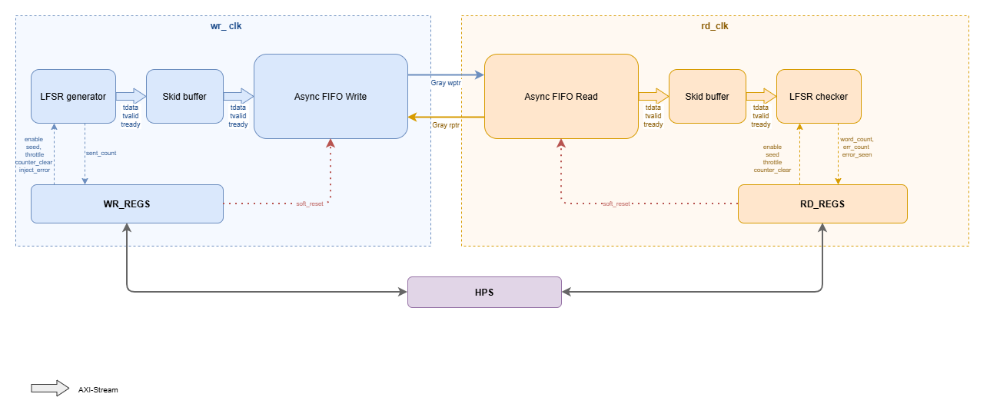

# AXI4-Stream CDC Bridge (DE1-SoC)

## 1. Overview

This project moves an AXI4-Stream data stream safely from one clock domain (`wr_clk`) to another (`rd_clk`) on the DE1-SoC's Cyclone V FPGA, and checks itself while doing it. An LFSR generator produces a pseudo-random 8-bit stream, which passes through a skid buffer into an asynchronous FIFO that does the clock crossing using Gray-coded pointers and 2-flop synchronizers. On the read side, a second skid buffer feeds an LFSR checker that runs the same LFSR from the same seed, predicts every word, and counts any mismatches. Both ends can randomly throttle their side of the handshake, so the bridge is tested under backpressure, a FIFO that fills up, and a FIFO that runs empty. Lost, duplicated or corrupted data shows up as a non-zero error count. The ARM processor (HPS) starts, configures and monitors the bridge through two register blocks, one in each clock domain.

## 2. Features

- **Clock domain crossing:** AXI4-Stream bridge between two unrelated clocks (`wr_clk` → `rd_clk`) through an async FIFO with Gray-coded pointers and 2-flop synchronizers.
- **Built-in self-test:** an LFSR generator (8-bit, x⁸ + x⁶ + x⁵ + x⁴ + 1) sends a pseudo-random stream; an LFSR checker with the same seed predicts and checks every word.
- **Error counting:** counts words sent, words received and mismatched words, plus a sticky error flag.
- **Error injection:** one register write corrupts exactly one word, to prove the checker works (after N injections, `ERR_COUNT` = N).
- **Backpressure testing:** independent random throttle on each side (0–255) makes the FIFO run full, empty and in between.
- **Full throughput:** one word per clock on each side; skid buffers register every block boundary without losing speed.
- **AXI4-Stream throughout:** standard `tdata` / `tvalid` / `tready` handshake between all blocks.
- **Two register blocks:** one per clock domain, each an Avalon-MM slave on the HPS lightweight bridge, so there are no custom control or status clock crossings.
- **Three reset levels:** hard reset (everything), soft reset (datapath only, registers kept) and counter clear (statistics only).
- **Parameterized FIFO:** data width and depth (`DATA_WIDTH`, `ADDR_WIDTH`); default 16 × 8-bit in logic cells.
- **Software control:** the ARM (HPS) configures, starts, stops and monitors everything from C code.

### Configuration requirements

- The seed must be non-zero (0 locks up the LFSR).
- The same seed must be written to both WR SEED and RD SEED.
- Soft reset must be set in both register blocks before it is cleared in either.

## 3. Implementation

### 3a AXI - Stream

AXI4-Stream is a protocol rather than a separate module: each block implements its side of the handshake directly in its ports, with `m_` prefixes for master (sending) ports and `s_` prefixes for slave (receiving) ports. Every block in the datapath (generator, skid buffers, FIFO and checker) uses the same handshake, so each block can be built, tested and replaced on its own. AXI4-Stream was chosen because it is the industry-standard streaming interface and the simplest one that supports backpressure: the receiver can make the sender wait, so no data is lost when the FIFO is full or the checker is busy, which a plain data-plus-valid bus cannot do. The sender drives `tdata` and raises `tvalid` when it has data, the receiver raises `tready` when it can accept, and a word transfers on every clock edge where both are high. Once `tvalid` is high, the sender must hold `tdata` steady until the transfer happens, while the receiver may change `tready` at any time. This design uses only `tdata[7:0]`, `tvalid` and `tready`. `tlast`, which marks the last word of a packet, is not needed because the LFSR stream is one continuous sequence, so it is tied to 0 and only carried through the FIFO to keep the FIFO wrapper reusable for packet-based designs.

### 3b LFSR Generator and Checker

### 3c Skid buffer

A skid buffer is a pipeline stage that works with AXI4-Stream backpressure, and one sits on each side of the FIFO to give the datapath short timing paths without losing throughput. Short paths: the skid buffer registers both directions of the handshake, data and `tvalid` going forward and `tready` going back (`s_tready = !skid_valid`), so no signal passes through more than one block in a single clock cycle. The biggest benefit is on the read side, where skid buffer B stores the FIFO's output, which is read from logic-cell memory through a 16-to-1 mux, before it reaches the checker's compare logic; without it, the memory read and the compare would have to finish in the same cycle. Full throughput: a plain register would also shorten the paths, but with a registered `tready` it can only accept a new word after it sees its slot is empty, which it learns one cycle late, so it moves one word every two cycles. The skid buffer adds a second ("skid") slot, so its `tready` stays high while words flow and the main slot passes one word out and takes one in every cycle. When the downstream block stalls, the one word already on its way lands in the skid slot instead of being lost, and only then does `tready` drop. On the write side the generator and FIFO already drive registered signals, so skid buffer A mainly keeps that boundary registered so either block can be changed later without affecting the other's timing. The cost is one clock cycle of latency and one extra data register per skid buffer.

### 3d Async FIFO

The async FIFO is where data crosses from `wr_clk` to `rd_clk`, letting the two sides run at different, unrelated speeds without losing a word. A FIFO was chosen over a simple handshake synchronizer because it moves one word per clock instead of one word every few clocks, and its 16 entries absorb short bursts when one side runs ahead. Data is written into memory on `wr_clk` and read out on `rd_clk`; only the read and write pointers cross between the clocks, in Gray code through 2-flop synchronizers. Gray code is used because only one bit changes per step, so a pointer can never be captured half-updated. Each side compares its own pointer with the other side's synchronized pointer to know when the FIFO is full or empty.

### 3e HPS
### 3f Reset
| Level | Source | Resets | Keeps |
|-------|--------|--------|-------|
| Hard reset | `h2f_rst_n` through the Platform Designer reset controller (one synchronizer per clock domain) | Everything, including both register blocks | Nothing |
| Soft reset | `CTRL.soft_reset` in each block | That block's side of the datapath: FIFO side, skid buffer, LFSR, counters, flags | Register values |
| Counter clear | `CTRL.counter_clear` in each block | That block's counters and flags only | LFSR, data in flight, register values |
All modules use an asynchronous reset that is released synchronously. In each domain the reset is one register, `rst <= hard_rst | soft_reset`, so it is glitch-free and leaves reset on a clock edge.

`soft_reset` is a level, not a pulse, because both FIFO pointers must be in reset at the same time. Set it in both blocks, then clear it in both blocks. Disable both enables first; see Operational sequence for the exact order.

## 4. Registers

The ARM accesses two register blocks through the lightweight HPS-to-FPGA bridge (base `0xFF200000`). Each block is an Avalon-MM slave clocked by the domain it controls. Platform Designer inserts the clock crossing between the bus and each block, so no control or status signal crosses between `wr_clk` and `rd_clk` inside the design. The only crossing in the datapath is the async FIFO.

| Block   | Clock    | Base (proposed) | Controls                                  |
|---------|----------|-----------------|-------------------------------------------|
| WR_REGS | `wr_clk` | `0xFF200000`    | Generator, skid buffer A, FIFO write side |
| RD_REGS | `rd_clk` | `0xFF200100`    | Checker, skid buffer B, FIFO read side    |

Final base addresses are assigned in Platform Designer. Offsets below are in bytes from each block's base.

Access codes: RW = read/write, RO = read-only, W = write-only, SC = self-clearing (write 1 gives a one-cycle pulse, reads as 0), sticky = set by hardware and held until cleared.

### WR_REGS (wr_clk)

| Offset | Name       | Access | Description                                        |
|--------|------------|--------|----------------------------------------------------|
| 0x00   | CTRL       | RW     | Enable, soft reset, error injection, counter clear |
| 0x04   | SEED       | RW     | Generator LFSR seed                                |
| 0x08   | THROTTLE   | RW     | Generator pause rate                               |
| 0x0C   | SENT_COUNT | RO     | Words sent by the generator                        |

#### WR CTRL (offset 0x00)

| Bits | Field         | Access | Reset | Description |
|------|---------------|--------|-------|-------------|
| 0    | enable        | RW     | 0     | 1 = generator sends words. 0 = generator pauses and keeps its state. |
| 1    | soft_reset    | RW     | 0     | 1 = hold the write side of the datapath in reset. The LFSR reloads from SEED. Registers keep their values. |
| 2    | inject_error  | W, SC  | 0     | Write 1 to corrupt exactly one word (XOR on the generator's output `tdata`; the LFSR sequence is not changed). After N writes, RD `ERR_COUNT` should equal N. |
| 3    | counter_clear | W, SC  | 0     | Write 1 to zero SENT_COUNT. |
| 31:4 | reserved      | RO     | 0     | Reads as 0. |

#### WR SEED (offset 0x04)

| Bits | Field    | Access | Reset | Description |
|------|----------|--------|-------|-------------|
| 7:0  | seed     | RW     | 0x01  | Generator LFSR start value. Loaded on reset or soft reset. Must be non-zero and must equal RD SEED. |
| 31:8 | reserved | RO     | 0     | Reads as 0. |

#### WR THROTTLE (offset 0x08)

| Bits | Field    | Access | Reset | Description |
|------|----------|--------|-------|-------------|
| 7:0  | throttle | RW     | 0     | Generator pause rate. Sends a word in a cycle when its random value ≥ throttle. 0 = full speed, 128 ≈ half speed, 255 ≈ almost stopped. |
| 31:8 | reserved | RO     | 0     | Reads as 0. |

#### WR SENT_COUNT (offset 0x0C)

| Bits | Field      | Access | Reset | Description |
|------|------------|--------|-------|-------------|
| 31:0 | sent_count | RO     | 0     | Words accepted from the generator (tvalid && tready). Cleared by reset, soft reset or counter clear. Wraps at 2³². |

### RD_REGS (rd_clk)

| Offset | Name       | Access | Description                              |
|--------|------------|--------|------------------------------------------|
| 0x00   | CTRL       | RW     | Enable, soft reset, counter clear        |
| 0x04   | SEED       | RW     | Checker LFSR seed                        |
| 0x08   | THROTTLE   | RW     | Checker backpressure rate                |
| 0x0C   | STATUS     | RO     | Error status                             |
| 0x10   | WORD_COUNT | RO     | Words received by the checker            |
| 0x14   | ERR_COUNT  | RO     | Mismatched words seen by the checker     |

#### RD CTRL (offset 0x00)

| Bits | Field         | Access | Reset | Description |
|------|---------------|--------|-------|-------------|
| 0    | enable        | RW     | 0     | 1 = checker accepts words. 0 = checker holds `tready` low and keeps its state. |
| 1    | soft_reset    | RW     | 0     | 1 = hold the read side of the datapath in reset. The LFSR reloads from SEED. Registers keep their values. |
| 2    | reserved      | RO     | 0     | Kept free so bit positions match WR CTRL. |
| 3    | counter_clear | W, SC  | 0     | Write 1 to zero WORD_COUNT, ERR_COUNT and STATUS.error_seen. |
| 31:4 | reserved      | RO     | 0     | Reads as 0. |

#### RD SEED (offset 0x04)

| Bits | Field    | Access | Reset | Description |
|------|----------|--------|-------|-------------|
| 7:0  | seed     | RW     | 0x01  | Checker LFSR start value. Loaded on reset or soft reset. Must be non-zero and must equal WR SEED. |
| 31:8 | reserved | RO     | 0     | Reads as 0. |

#### RD THROTTLE (offset 0x08)

| Bits | Field    | Access | Reset | Description |
|------|----------|--------|-------|-------------|
| 7:0  | throttle | RW     | 0     | Checker backpressure rate. Accepts a word in a cycle when its random value ≥ throttle. 0 = always ready, higher = drops `tready` more often. |
| 31:8 | reserved | RO     | 0     | Reads as 0. |

#### RD STATUS (offset 0x0C)

| Bits | Field      | Access     | Reset | Description |
|------|------------|------------|-------|-------------|
| 0    | error_seen | RO, sticky | 0     | Set on the first mismatched word. Cleared by reset, soft reset or counter clear. |
| 31:1 | reserved   | RO         | 0     | Reads as 0. |

#### RD WORD_COUNT (offset 0x10)

| Bits | Field      | Access | Reset | Description |
|------|------------|--------|-------|-------------|
| 31:0 | word_count | RO     | 0     | Words accepted by the checker. Cleared by reset, soft reset or counter clear. Wraps at 2³². When it equals WR SENT_COUNT, every sent word has reached the checker. |

#### RD ERR_COUNT (offset 0x14)

| Bits | Field     | Access | Reset | Description |
|------|-----------|--------|-------|-------------|
| 31:0 | err_count | RO     | 0     | Accepted words that did not match the checker's prediction. Cleared by reset, soft reset or counter clear. |

## 5. Interface

| Signal         | Dir | Width | Clock    | Description |
|----------------|-----|-------|----------|-------------|
| `wr_clk`       | in  | 1     |          | Write-side clock |
| `wr_rst`       | in  | 1     | `wr_clk` | Write-side reset, active high |
| `gen_enable`   | in  | 1     | `wr_clk` | Enables LFSR Generator |
| `gen_clear`    | in  | 1     | `wr_clk` | Clear `sent_count` |
| `gen_inject`   | in  | 1     | `wr_clk` |  One-cycle pulse: XOR the next accepted word's `tdata` to create exactly one error LFSR sequence unchanged; |
| `gen_seed`     | in  | 8     | `wr_clk` | LFSR Generator seed value |
| `gen_throttle` | in  | 8     | `wr_clk` | LFSR Generator pause rate |
| `sent_count`   | out | 32    | `wr_clk` | Counter increments after every word sent |
| `rd_clk`       | in  | 1     |          | Read-side clock |
| `rd_rst`       | in  | 1     | `rd_clk` | Read-side reset, active high |
| `chk_enable`   | in  | 1     | `rd_clk` | Enables the LFSR checker |
| `chk_clear`    | in  | 1     | `rd_clk` | Clears `word_count`, `err_count`, `error_seen` |
| `chk_seed`     | in  | 8     | `rd_clk` | LFSR Checker seed value |
| `chk_throttle` | in  | 8     | `rd_clk` | LFSR Checker backpressure rate |
| `word_count`   | out | 32    | `rd_clk` | Counts number of words received on the LFSR checker side |
| `err_count`    | out | 32    | `rd_clk` | Counter increments after every mismatched words is detected |
| `error_seen`   | out | 1     | `rd_clk` | Error flag. Level held after first error detected |