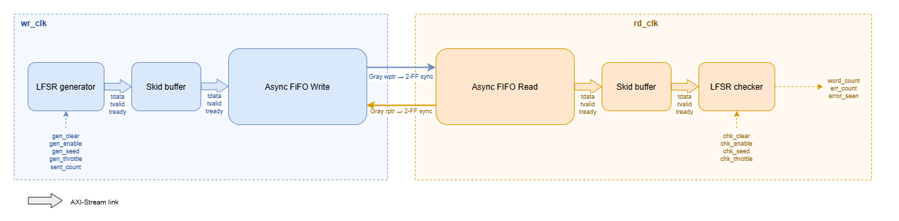

# AXI4-Stream CDC Bridge (DE1-SoC)

## Overview

This project moves an AXI4-Stream data stream safely from one clock domain (`wr_clk`) to another (`rd_clk`) on the DE1-SoC's Cyclone V FPGA, and checks itself while doing it. An LFSR generator produces a pseudo-random 8-bit stream, which passes through a skid buffer into an asynchronous FIFO that does the clock crossing using Gray-coded pointers and 2-flop synchronizers. On the read side, a second skid buffer feeds an LFSR checker that runs the same LFSR from the same seed, predicts every word, and counts any mismatches. Both ends can randomly throttle their side of the handshake, so the bridge is tested under backpressure, a FIFO that fills up, and a FIFO that runs empty. Lost, duplicated or corrupted data shows up as a non-zero error count. Later, the ARM processor (HPS) will start, configure and monitor the bridge through a register block.

