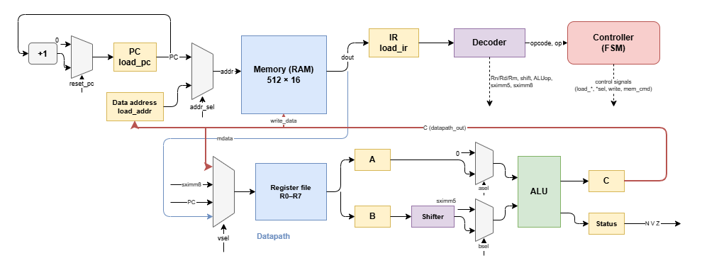

# RISC-16 CPU — learning notes

A 16-bit RISC CPU (Simple RISC Machine style) built from a datapath, a register file, an ALU, a shifter, an instruction decoder and a finite-state-machine controller, with a 512 × 16-bit RAM holding both program and data.



## Files

| File | What it is |
|------|------------|
| `cpu.sv` | Top of the CPU: instruction register, PC, memory address logic; connects datapath, controller and decoder |
| `controller.sv` | FSM that sequences every instruction (fetch, decode, execute) |
| `decoder.sv` | Splits the 16-bit instruction into fields (opcode, registers, immediates, shift) |
| `datapath.sv` | Registers A, B, C, the shifter, the ALU and the status flags |
| `regfile.sv` | 8 registers R0–R7, 16 bits each |
| `alu.sv` | ADD, SUB (for CMP), AND, NOT; computes N, V, Z |
| `shifter.sv` | None, LSL #1, LSR #1, ASR #1 |
| `ram.sv` | 512 × 16 memory, loaded from `data.txt` |
| `vDFF.sv` | Generic flip-flop used for the FSM state |
| `lab7_top.sv` | Board top level (unfinished) |
| `execute.sv` | Old leftover, not used |

## Instruction set

| Instruction | opcode / op | What it does |
|-------------|-------------|--------------|
| `MOV Rn, #im8` | `110` / `10` | Rn = sign-extended 8-bit constant |
| `MOV Rd, Rm{, sh}` | `110` / `00` | Rd = Rm, optionally shifted |
| `ADD Rd, Rn, Rm{, sh}` | `101` / `00` | Rd = Rn + shifted Rm |
| `CMP Rn, Rm{, sh}` | `101` / `01` | Rn − shifted Rm, only sets N / V / Z |
| `AND Rd, Rn, Rm{, sh}` | `101` / `10` | Rd = Rn AND shifted Rm |
| `MVN Rd, Rm{, sh}` | `101` / `11` | Rd = NOT shifted Rm |
| `LDR Rd, [Rn{, #im5}]` | `011` / `00` | Rd = memory[Rn + im5] |
| `STR Rd, [Rn{, #im5}]` | `100` / `00` | memory[Rn + im5] = Rd |
| `HALT` | `111` / `xx` | Stop until reset |

Shift (`sh`): `00` none, `01` LSL #1, `10` LSR #1, `11` ASR #1 (keeps the sign bit).

### Instruction encoding (16 bits)

```
15 13 | 12 11 | 10  8 | 7  5 | 4  3 | 2  0
opcode|  op   |  Rn   |  Rd  |  sh  |  Rm      ALU / MOV register forms
opcode|  op   |  Rn   |      im8               MOV immediate
opcode|  op   |  Rn   |  Rd  |     im5         LDR / STR
```

## How an instruction runs

The controller is a state machine. Every instruction goes through:

1. **RST**: PC = 0 (only after reset).
2. **IF1**: put the PC on the memory address and start a read.
3. **IF2**: the memory word arrives; load it into the instruction register (IR).
4. **UPDATEPC**: PC = PC + 1, and choose the next state from the opcode.
5. **Execute states**, depending on the instruction:
   - MOV immediate: write `sximm8` into Rn (**S1**).
   - ALU ops: read Rn into A (**GetA**), Rm into B (**GetB**), compute into C (**Computations**), write C into Rd (**WriteReg**).
   - LDR / STR: compute the address Rn + im5, then read or write memory.
   - HALT: stay in **HALT** until reset.
6. Back to **IF1** for the next instruction.

## Fix log

| Date | File | Fix | Why |
|------|------|-----|-----|
| 2026-11-26 | `cpu.sv` | Declared `PC` before use; declared `reset_pc`, `load_pc`, `addr_sel`, `load_addr`, `mem_cmd[1:0]` | Undeclared names became 1-bit implicit wires; `mem_cmd` was truncated so MREAD / MWRITE never matched |
| 2026-11-26 | `cpu.sv` | `write_data = out`, `mdata = read_data` | Both were never driven: LDR loaded X, STR addresses were X |
| 2026-11-26 | `controller.sv` | `addr_sel` declared once; `vsel` made 2 bits | Compile errors |
| 2026-11-26 | `controller.sv` | Added a HALT row that stays in HALT | HALT fell into `default` and restarted the program |
| 2026-11-26 | `controller.sv` | `default` row made 24 bits | It was 23 bits, which shifted every control signal by one |

## Still to do

- LDR timing (`load_addr` one state late; keep MREAD in LDR2)
- STR needs an extra state (load B = Rd, then C = 0 + B, then MWRITE)
- `vDFF`: use `<=` instead of `=`
- `datapath.sv`: `{7'b0, pc}` instead of `{8'b0, pc}`
- Remove `execute.sv`; finish `lab7_top.sv`
- Branches (B, BEQ, BNE, BLT, BLE, BL, BX, BLX)
- Memory-mapped I/O (switches, LEDs); clock from `CLOCK_50`
- Possibly rewrite the controller in the enum + defaults style

## Lessons learned

- **Declare before use.** In Verilog, an unknown name becomes a 1-bit implicit wire, so multi-bit signals silently lose bits.
- **Packed control vectors are fragile.** One missing bit in a 24-bit `next` vector shifts every signal. Named outputs with defaults are safer.
- **`vlib` can't create parent folders.** The `logs` folder must exist before `vlib logs/work`.
